# 实验三 Android 界面组件 实验报告

## 一、实验目的

1. 掌握 **ListView** 与 **SimpleAdapter** 的配合使用，实现「图片 + 文字」列表，并处理列表项的单击事件。
2. 掌握 `AlertDialog.Builder.setView()` 自定义对话框布局的方法，实现带样式的登录对话框。
3. 掌握使用 **XML** 定义选项菜单（`onCreateOptionsMenu` / `onOptionsItemSelected`），并实现子菜单。
4. 掌握 **上下文操作模式（ActionMode）** 的使用，实现列表多选与批量删除。
5. 掌握 **RecyclerView** + `ViewHolder` + `Adapter` 的列表实现，并利用 `notifyItemInserted` 实现局部刷新。

## 二、实验环境

| 项目 | 说明 |
|------|------|
| 操作系统 | Windows 11 |
| 开发工具 | Android Studio |
| 编程语言 | Kotlin |
| 构建工具 | Gradle（Kotlin DSL，AGP 9.3、Gradle 9.5） |
| 最低 SDK | 24（Android 7.0） |
| 目标 SDK | 37 |
| 依赖库 | androidx.recyclerview:recyclerview 1.4.0、Jetpack Compose（Material 3） |
| 测试设备 | Android 模拟器（Android 15，320×640） |

## 三、实验内容

应用启动后进入一个 Compose 实现的导航菜单，列出 5 个实验任务入口，点击对应按钮跳转到各组件界面。

<div align="center">

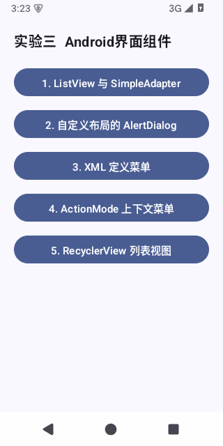

*图1　实验导航主菜单*

</div>

---

### 任务一　ListView 与 SimpleAdapter

#### 任务描述

使用 SimpleAdapter 实现一个「图片 + 名称」列表，单击列表项时用 Toast 显示所选项内容，并发送一条通知：通知 Icon 为应用程序图标，Title 为列表项内容。

#### 实现要点

- 列表项布局 `item_animal.xml` 为横向 `LinearLayout`：左侧名称 `TextView`（`layout_weight="1"` 占满剩余宽度），右侧 `ImageView`。
- `SimpleAdapter` 的数据为 `List<Map<String, Any>>`，`from` 为 `["name","image"]`，`to` 为 `[R.id.tvName, R.id.ivImage]`；`image` 的值直接是 `R.drawable.*` 资源 id，会被自动绑定到 ImageView。
- 单击事件 `setOnItemClickListener` 中先弹出 Toast，再调用 `sendNotification(name)`。
- 通知：`NotificationCompat.Builder` 的 `setSmallIcon(R.mipmap.ic_launcher)`、`setContentTitle(name)`，使用 `NotificationManager` 发送。
- Android 13+ 需要 `POST_NOTIFICATIONS` 运行时权限，通过 `ActivityCompat.requestPermissions` 申请（Manifest 中已声明）。

#### 核心代码

```kotlin
val animals = listOf(
    "Lion" to R.drawable.lion, "Tiger" to R.drawable.tiger,
    "Monkey" to R.drawable.monkey, "Dog" to R.drawable.dog,
    "Cat" to R.drawable.cat, "Elephant" to R.drawable.elephant
)
// Map 中的 image 值为资源 id，SimpleAdapter 会自动绑定到 ImageView
val data: List<Map<String, Any>> = animals.map { mapOf("name" to it.first, "image" to it.second) }
val adapter = SimpleAdapter(
    this, data, R.layout.item_animal,
    arrayOf("name", "image"), intArrayOf(R.id.tvName, R.id.ivImage)
)
listView.adapter = adapter

listView.setOnItemClickListener { _, _, position, _ ->
    val name = animals[position].first
    Toast.makeText(this, name, Toast.LENGTH_SHORT).show()   // 显示所选内容
    sendNotification(name)                                  // 发送通知
}

private fun sendNotification(name: String) {
    val notification = NotificationCompat.Builder(this, CHANNEL_ID)
        .setSmallIcon(R.mipmap.ic_launcher)          // Icon 为应用图标
        .setContentTitle(name)                       // Title 为列表项内容
        .setContentText("你单击了列表项：$name")
        .setAutoCancel(true)
        .build()
    getSystemService(NotificationManager::class.java).notify(name.hashCode(), notification)
}
```

#### 运行效果

<div align="center">

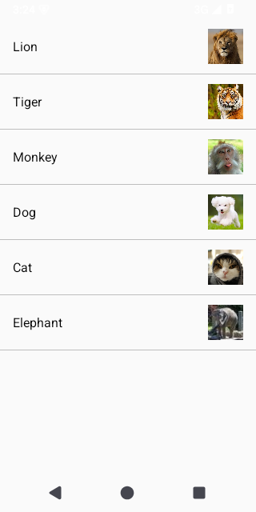

*图2　SimpleAdapter 实现的图片 + 名称列表*

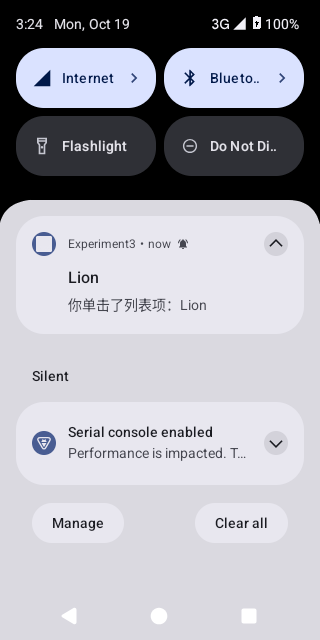

*图3　点击 Lion 后发送通知，通知标题为列表项内容*

</div>

---

### 任务二　自定义布局的 AlertDialog

#### 任务描述

创建自定义布局的 AlertDialog：对话框顶部为橙色标题栏「ANDROID APP」，中部是 Username / Password 输入框，底部为 Cancel / Sign in 按钮。

#### 实现要点

- 用 `layoutInflater.inflate(R.layout.dialog_login, null)` 加载自定义布局 `dialog_login.xml`。
- 标题栏是 56dp 高、橙色（`#FFFFA000`）背景的 `TextView`，文字居中加粗。
- 两个 `EditText`：Username 普通文本，Password 设 `inputType="textPassword"` 隐藏输入。
- `AlertDialog.Builder` 通过 `setView()` 绑定该布局，并设置 `setNegativeButton("Cancel")`、`setPositiveButton("Sign in")`；Sign in 时读取输入内容并 Toast 显示。
- 进入页面立即展示一次对话框（`onCreate` 中调用 `showCustomDialog()`），也可点击页面按钮再次打开。

#### 核心代码

```kotlin
private fun showCustomDialog() {
    val contentView = layoutInflater.inflate(R.layout.dialog_login, null)

    AlertDialog.Builder(this)
        .setView(contentView)
        .setNegativeButton("Cancel") { dialog, _ -> dialog.dismiss() }
        .setPositiveButton("Sign in") { _, _ ->
            val username = contentView.findViewById<EditText>(R.id.etUsername).text.toString()
            val password = contentView.findViewById<EditText>(R.id.etPassword).text.toString()
            Toast.makeText(this, "Sign in：$username / $password", Toast.LENGTH_SHORT).show()
        }
        .show()
}
```

```xml
<!-- dialog_login.xml：橙色标题栏 + 输入框 -->
<TextView
    android:layout_width="match_parent"
    android:layout_height="56dp"
    android:background="@color/dialog_header"
    android:gravity="center"
    android:text="ANDROID APP"
    android:textColor="@color/white"
    android:textSize="20sp"
    android:textStyle="bold" />

<EditText android:id="@+id/etUsername" android:hint="Username" android:inputType="text" />
<EditText android:id="@+id/etPassword" android:hint="Password" android:inputType="textPassword" />
```

#### 运行效果

<div align="center">

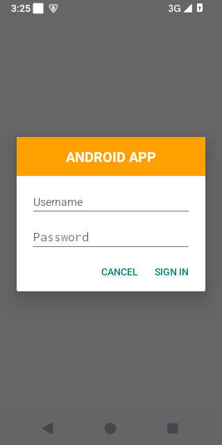

*图4　橙色标题栏 + Username / Password + Cancel / Sign in 的自定义对话框*

</div>

---

### 任务三　XML 定义菜单

#### 任务描述

使用 XML 定义选项菜单：包含「字体大小」子菜单（小 / 中 / 大，分别对应 10、16、20 号字）、一个普通菜单项（点击弹出 Toast）、以及「字体颜色」子菜单（红 / 黑）。界面标题为 MenuTest，并有一个用于测试的输入框。

#### 实现要点

- 该页面使用带 ActionBar 的主题 `Theme.Experiment3.ActionBar`，在 `onCreateOptionsMenu` 中 `menuInflater.inflate(R.menu.main_menu, menu)` 加载菜单。
- 菜单 `main_menu.xml` 中，「字体大小」「字体颜色」两项用嵌套 `<menu>` 定义子菜单。
- `onOptionsItemSelected` 根据 id 分发：`size_small/medium/large` 调用 `etTest.setTextSize(10/16/20)`；`menu_normal` 弹 Toast；`color_red/color_black` 调用 `etTest.setTextColor(Color.RED/BLACK)`。
- 在 `onCreate` 中设置 `title = "MenuTest"`。

#### 核心代码

```xml
<!-- res/menu/main_menu.xml -->
<item android:id="@+id/menu_font_size" android:title="字体大小">
    <menu>
        <item android:id="@+id/size_small"  android:title="小" />
        <item android:id="@+id/size_medium" android:title="中" />
        <item android:id="@+id/size_large"  android:title="大" />
    </menu>
</item>
<item android:id="@+id/menu_normal" android:title="普通菜单项" />
<item android:id="@+id/menu_font_color" android:title="字体颜色">
    <menu>
        <item android:id="@+id/color_red"   android:title="红色" />
        <item android:id="@+id/color_black" android:title="黑色" />
    </menu>
</item>
```

```kotlin
override fun onCreateOptionsMenu(menu: Menu): Boolean {
    menuInflater.inflate(R.menu.main_menu, menu)
    return true
}

override fun onOptionsItemSelected(item: MenuItem): Boolean {
    when (item.itemId) {
        R.id.size_small  -> etTest.setTextSize(10f)   // 小：10 号字
        R.id.size_medium -> etTest.setTextSize(16f)   // 中：16 号字
        R.id.size_large  -> etTest.setTextSize(20f)   // 大：20 号字
        R.id.menu_normal -> Toast.makeText(this, "你点击了普通菜单项", Toast.LENGTH_SHORT).show()
        R.id.color_red   -> etTest.setTextColor(Color.RED)
        R.id.color_black -> etTest.setTextColor(Color.BLACK)
        else -> return super.onOptionsItemSelected(item)
    }
    return true
}
```

#### 运行效果

<div align="center">

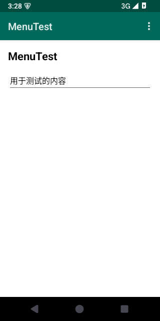

*图5　MenuTest 界面（ActionBar 标题 + 测试输入框）*

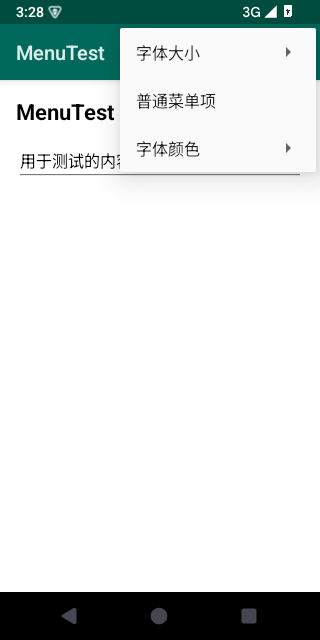

*图6　展开的选项菜单：字体大小、普通菜单项、字体颜色*

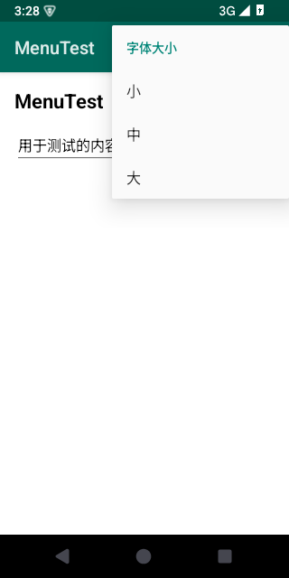

*图7　字体大小子菜单：小 / 中 / 大*

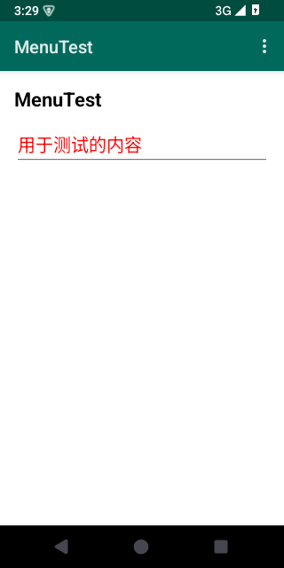

*图8　选择「大」字号与「红」色后，测试文本变为大号红色*

</div>

---

### 任务四　ActionMode 上下文菜单

#### 任务描述

使用 ActionMode 创建上下文操作模式：列表展示 One / Two / Three / Four / Five 五项（每项前有 Android 机器人图标），长按列表项进入多选模式，顶部显示已选数量与删除图标，点击删除按钮删除选中项。

#### 实现要点

- 该页面同样使用带 ActionBar 的主题 `Theme.Experiment3.ActionBar`。
- 列表使用 `ListView`，`choiceMode = ListView.CHOICE_MODE_MULTIPLE_MODAL`（多选模态）。
- `setMultiChoiceModeListener(... AbsListView.MultiChoiceModeListener)`：
  - `onCreateActionMode` 中 `menuInflater.inflate(R.menu.menu_actionmode, menu)`，加载删除按钮（`ic_delete`）。
  - `onItemCheckedStateChanged` 中更新 ActionBar 标题为「已选 N 项」（`listView.checkedItemCount`）。
  - `onActionItemClicked` 中收集被选中的位置，从数据源 `ArrayList` 删除并 `notifyDataSetChanged()`，随后 `mode.finish()` 退出，并 Toast 提示删除数量。
- 列表项 `item_android.xml` 背景使用 `?android:attr/activatedBackgroundIndicator`，被选中时自动高亮。

#### 核心代码

```kotlin
listView.choiceMode = ListView.CHOICE_MODE_MULTIPLE_MODAL
listView.setMultiChoiceModeListener(object : AbsListView.MultiChoiceModeListener {

    override fun onCreateActionMode(mode: ActionMode, menu: Menu): Boolean {
        menuInflater.inflate(R.menu.menu_actionmode, menu)
        return true
    }

    override fun onPrepareActionMode(mode: ActionMode, menu: Menu): Boolean {
        mode.title = "已选 ${listView.checkedItemCount} 项"
        return true
    }

    override fun onActionItemClicked(mode: ActionMode, item: MenuItem): Boolean {
        if (item.itemId == R.id.action_delete) {
            val checked = listView.checkedItemPositions
            val toRemove = items.indices.filter { checked.get(it) }.map { items[it] }
            items.removeAll(toRemove.toSet())
            adapter.notifyDataSetChanged()
            mode.finish()
            Toast.makeText(this@ActionModeActivity, "已删除 ${toRemove.size} 项", Toast.LENGTH_SHORT).show()
            return true
        }
        return false
    }

    override fun onItemCheckedStateChanged(mode: ActionMode, position: Int, id: Long, checked: Boolean) {
        mode.title = "已选 ${listView.checkedItemCount} 项"
    }
})
```

#### 运行效果

<div align="center">

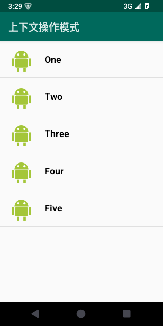

*图9　机器人图标 + One ~ Five 列表*

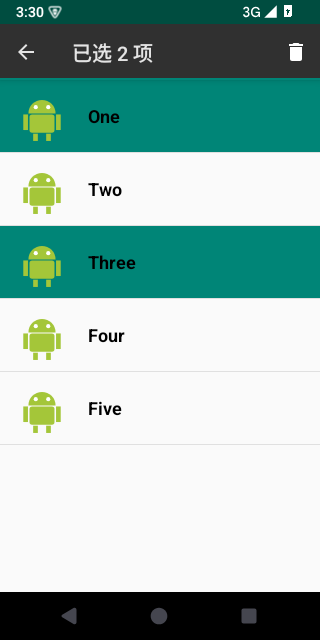

*图10　长按进入 ActionMode，标题显示「已选 2 项」，右上角为删除图标*

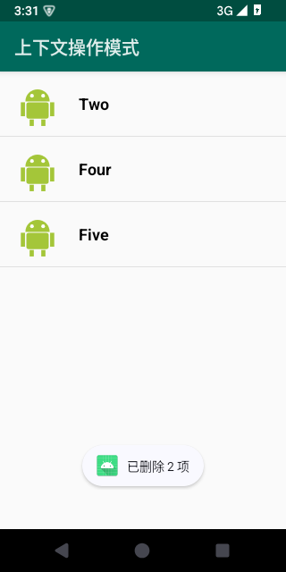

*图11　删除所选的两项，列表剩余 Three / Four / Five*

</div>

---

### 任务五　RecyclerView 列表视图

#### 任务描述

使用 RecyclerView 实现列表视图效果：列表项包含动物图片与名称，单击某一项后在该项下方增加一条新记录，列表实时更新。

#### 实现要点

- `RecyclerView` 设置 `LinearLayoutManager`，数据源为 `MutableList<Animal>`（`Animal` 含名称与 `@DrawableRes` 图片 id）。
- 自定义 `Adapter` 与 `ViewHolder`：`onCreateViewHolder` 加载 `item_recycler.xml`，`onBindViewHolder` 设置图片与名称并绑定点击事件。
- 点击时使用 `holder.bindingAdapterPosition` 获取当前绑定位置（避免刷新后错位），在该位置之后插入 `Animal("${name}（新增）", ...)`，并调用 `notifyItemInserted(position + 1)` 实现局部刷新。
- 列表项 `item_recycler.xml` 使用 `?android:attr/selectableItemBackground` 提供点击反馈。

#### 核心代码

```kotlin
class AnimalAdapter(
    private val items: List<Animal>,
    private val onClick: (Int) -> Unit
) : RecyclerView.Adapter<AnimalAdapter.AnimalViewHolder>() {

    class AnimalViewHolder(view: View) : RecyclerView.ViewHolder(view) {
        val ivAnimal: ImageView = view.findViewById(R.id.ivAnimal)
        val tvName: TextView = view.findViewById(R.id.tvAnimalName)
    }

    override fun onCreateViewHolder(parent: ViewGroup, viewType: Int): AnimalViewHolder {
        val view = LayoutInflater.from(parent.context).inflate(R.layout.item_recycler, parent, false)
        return AnimalViewHolder(view)
    }

    override fun onBindViewHolder(holder: AnimalViewHolder, position: Int) {
        val animal = items[position]
        holder.ivAnimal.setImageResource(animal.imgRes)
        holder.tvName.text = animal.name
        holder.itemView.setOnClickListener {
            val pos = holder.bindingAdapterPosition   // 保证点击对象正确、更新后不错位
            if (pos != RecyclerView.NO_POSITION) onClick(pos)
        }
    }

    override fun getItemCount(): Int = items.size
}

// Activity 中：点击后新增记录并局部刷新
recyclerView.adapter = AnimalAdapter(data) { position ->
    val animal = data[position]
    Toast.makeText(this, "点击了：${animal.name}", Toast.LENGTH_SHORT).show()
    data.add(position + 1, Animal("${animal.name}（新增）", animal.imgRes))
    recyclerView.adapter?.notifyItemInserted(position + 1)
}
```

#### 运行效果

<div align="center">

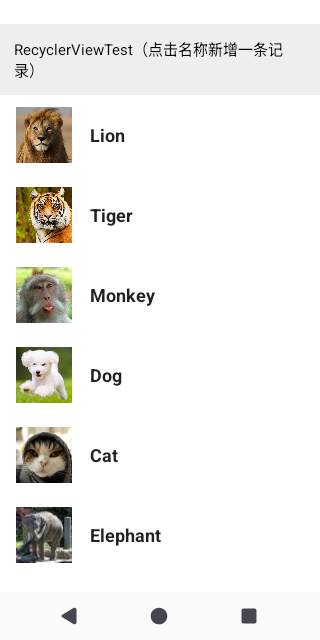

*图12　RecyclerView 展示动物图片与名称*

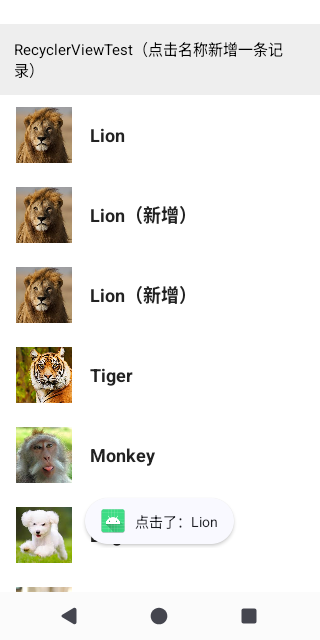

*图13　点击 Lion 后其下方新增两条「Lion（新增）」记录*

</div>

---

## 四、实验总结

1. **SimpleAdapter** 适合「图片 + 文字」的简单列表，通过 `Map` 中的资源 id 即可自动绑定 ImageView；若需要更复杂的列表项或更好的性能，应使用自定义 Adapter。
2. 自定义 `AlertDialog` 只需用 `setView()` 绑定一个自定义布局，即可实现带标题栏、输入框等任意样式的对话框。
3. 用 **XML** 定义菜单可读性好，子菜单通过嵌套 `<menu>` 实现；`onOptionsItemSelected` 中按 `itemId` 分发即可。
4. **ActionMode** 适合对列表项进行批量操作：`CHOICE_MODE_MULTIPLE_MODAL` + `MultiChoiceModeListener` 可自动维护选中状态，并配合 `?attr/activatedBackgroundIndicator` 高亮选中项。
5. **RecyclerView** 相比 ListView 强制使用 `ViewHolder` 复用，性能更优；通过 `notifyItemInserted` 等细粒度通知可实现局部刷新，配合 `bindingAdapterPosition` 可避免位置错乱。

> 注：targetSdk 35+ 会强制启用边到边（edge-to-edge）显示。任务三、任务四需要 ActionBar，因此在 `Theme.Experiment3.ActionBar` 中设置 `android:windowOptOutEdgeToEdgeEnforcement=true`，避免内容被 ActionBar 覆盖。
